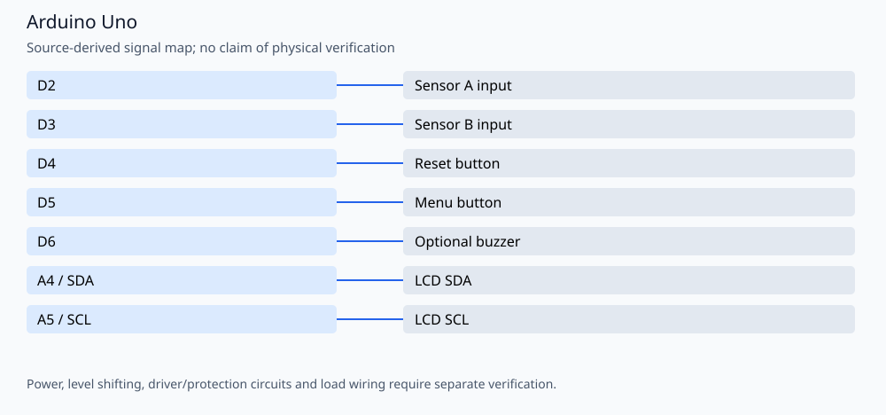

# Bidirectional IR counter with LCD and EEPROM

A two-sensor sequence counter with a 16×2 I2C LCD, menu, serial commands and periodic EEPROM storage. Author: **Amir Mobasheraghdam**. A→B increments and B→A decrements the count. Sensor timing and counting behavior is preserved.

## Reproducible build

Install Python 3 and **Arduino CLI 1.3.1**, then run from this repository:

```bash
python3 tools/check_firmware.py --install
```

The helper installs `arduino:avr@1.8.6` and `LiquidCrystal I2C@1.1.2`. It compiles these alternatives
separately in temporary folders, without uploading or rewriting the originals:

- `Arduino + IR Sensors.ino`

Build target: `arduino:avr:uno`. Once dependencies are installed, omit `--install`
to build offline. `--jobs 2` is the default. Set `ARDUINO_CLI` to a CLI executable
or wrapper when using a custom Arduino configuration. Exact build inputs are in
[`tools/firmware.json`](tools/firmware.json). Library dependencies are listed
explicitly and installed with `--no-deps` so transitive updates cannot silently
replace the pinned versions. These are tested build versions, not a claim that
all other core/library versions are incompatible.

The GitHub Actions workflow repeats the firmware checks on pushes and pull
requests. Compilation validates software/toolchain compatibility; it does not
establish hardware safety or successful physical operation.

## Signal assignments



| Signal | Board pin |
| --- | --- |
| Sensor A input | D2 |
| Sensor B input | D3 |
| Reset button | D4 |
| Menu button | D5 |
| Optional buzzer | D6 |
| LCD SDA | A4 / SDA |
| LCD SCL | A5 / SCL |

## Operation and validation limits

The LCD address is **0x27**. Buttons use `INPUT_PULLUP` and close to GND. Sensor inputs are active LOW; verify the voltage/interface of the actual sensor output before connecting it to an Uno. The optional buzzer is disabled by `USE_BUZZER = false`. Serial diagnostics use **115200 baud** (`s`: statistics, `r`: reset, `p`: current count). EEPROM saves changed counts every 10 seconds; this is not guaranteed power-fail capture.

The LCD cache is invalidated when a menu replaces the screen, so menu exit and timeout restore the main view even when the count/rate have not changed. The native regression test includes the production sketch with a recording LCD adapter and inert IO; it checks rendering, not physical sensors.

```bash
g++ -std=c++11 -Wall -Wextra -I tests/stubs tests/test_display.cpp -o /tmp/display-tests
/tmp/display-tests
```

No physical testing, new hardware photographs or measured electrical/optical
performance is claimed. Retain the author attribution and existing license/source
notices when reusing the project.
